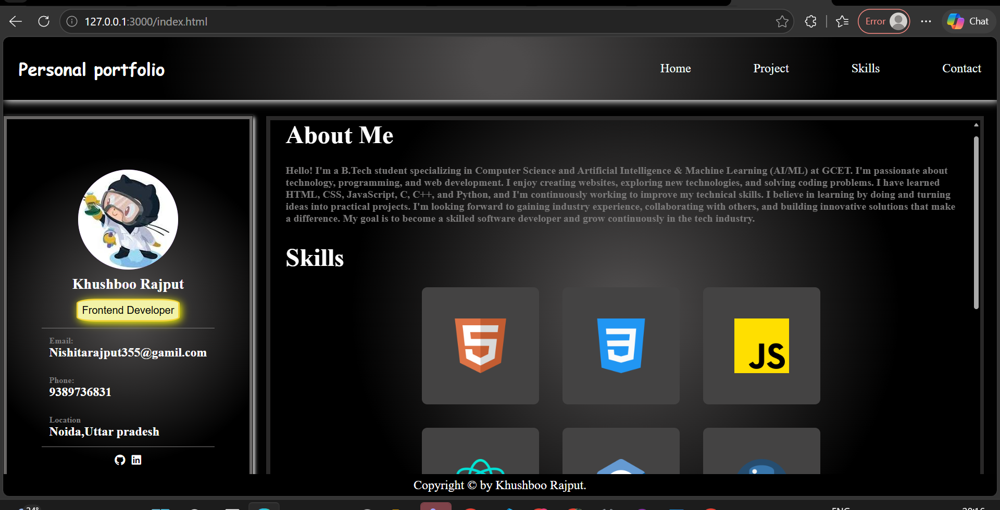
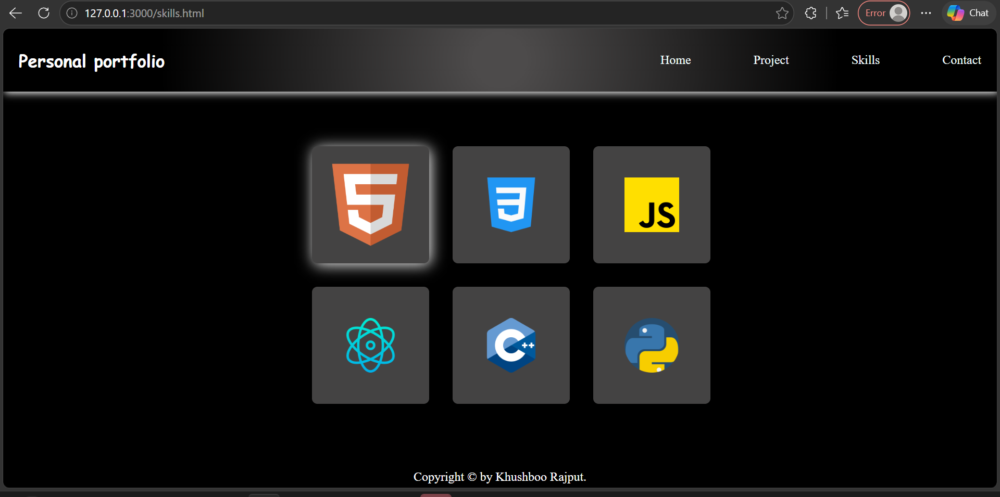
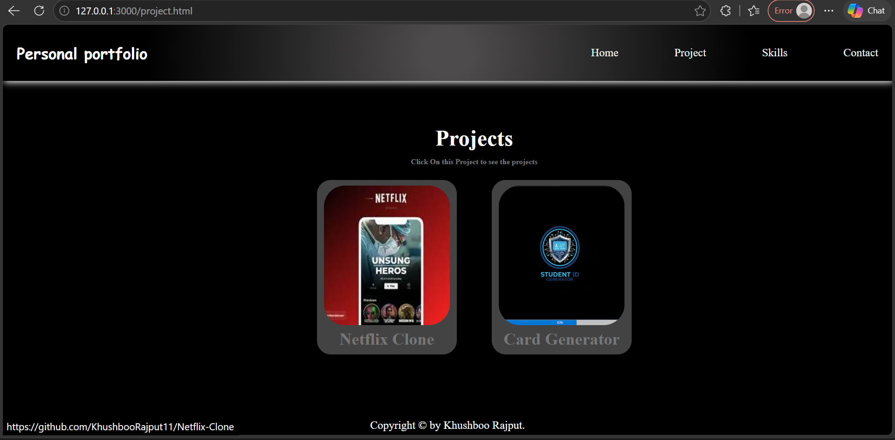
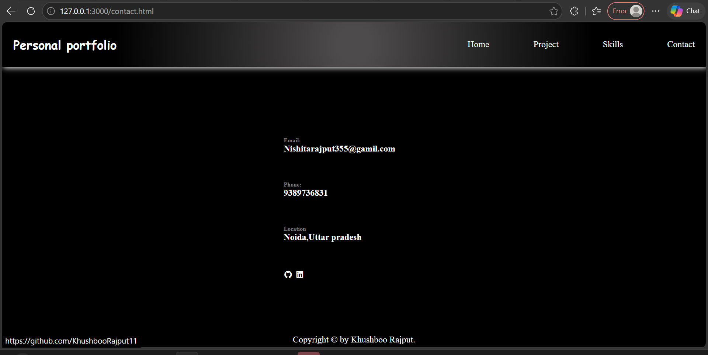

# ✨ Personal Portfolio Website

Welcome to my personal portfolio! 👋

This portfolio showcases my skills, projects, and contact information in one place. It highlights my web development journey, the technologies I work with, and the projects I have created.

## 🏠 Home

The Home section introduces me and gives visitors an overview of who I am, my interests, and my goals as a developer.

## 💻 Skills

Here are some of the technologies I use and am learning:

- **HTML5** — Structuring web pages
- **CSS3** — Styling, layouts, animations, and responsive design

*Update this list to match your actual skills.*

## 🚀 Projects

This section showcases some of my web development projects.

| Project | Description | Technologies |
|---|---|---|
| Netflix Clone | A Netflix-inspired landing page with a dark theme and trending movie cards. | HTML, CSS |
| Card Generator | A project for generating cards with a user-friendly interface. | Add your technologies |

*Include only projects you have actually built. Update the technologies to match each project.*

## 📬 Contact

I'd love to connect, collaborate, and learn from other developers!

- **GitHub:** [Visit My GitHub Profile](https://github.com/KhushbooRajput11)
- **LinkedIn:** www.linkedin.com/in/khushboo-rajput-a3a021435
- **Email:** nishitarajput355@gamil.com

## 🖼️ Screenshots

Screenshots of my portfolio website are included below to demonstrate its design and layout.

### 🏠 Home Page

### 💻 Skills Section

### 🚀 Projects Section

### 📬 Contact Section

> **Note:** Create a folder named `screenshots` in your repository and add the four screenshots using the exact filenames shown above. Otherwise, the images will not display.

## 🛠️ Technologies Used

- HTML5
- CSS3

## 🌐 Live Demo

🔗 **Portfolio Website:**

## 🎯 Purpose

This portfolio is designed to present my development skills, showcase my projects, and provide an easy way for others to contact me.

---

⭐ Thank you for visiting my portfolio repository!

**Made with ❤️ and creativity.**